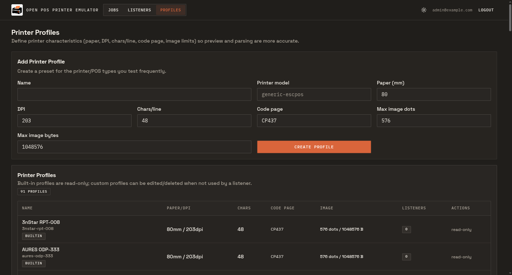
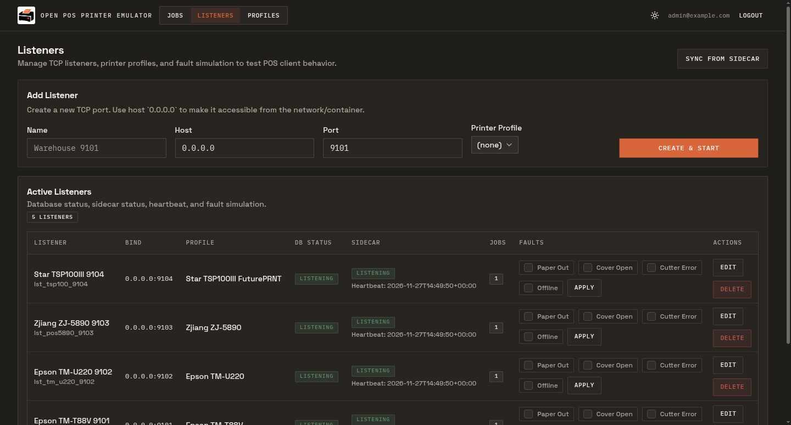
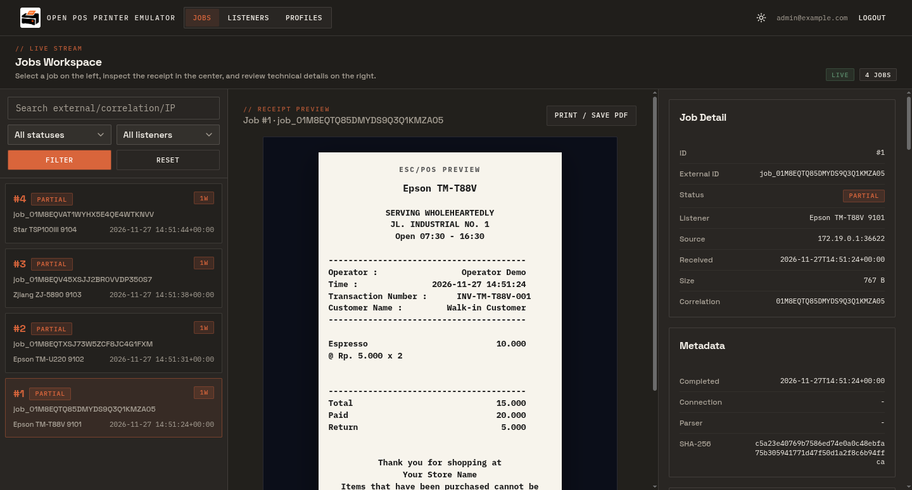
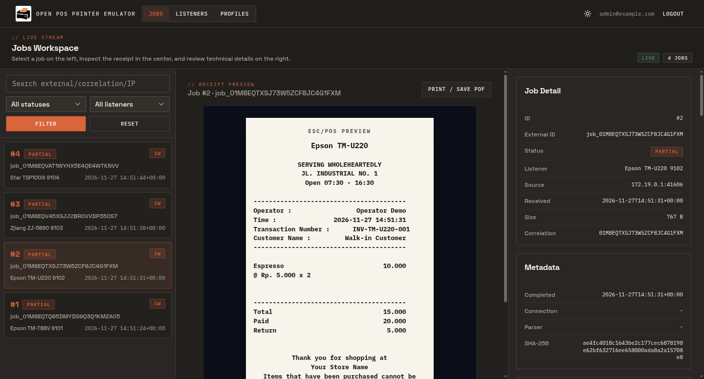
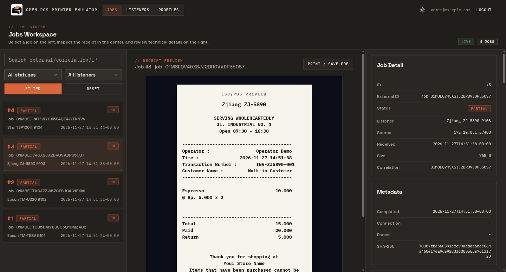
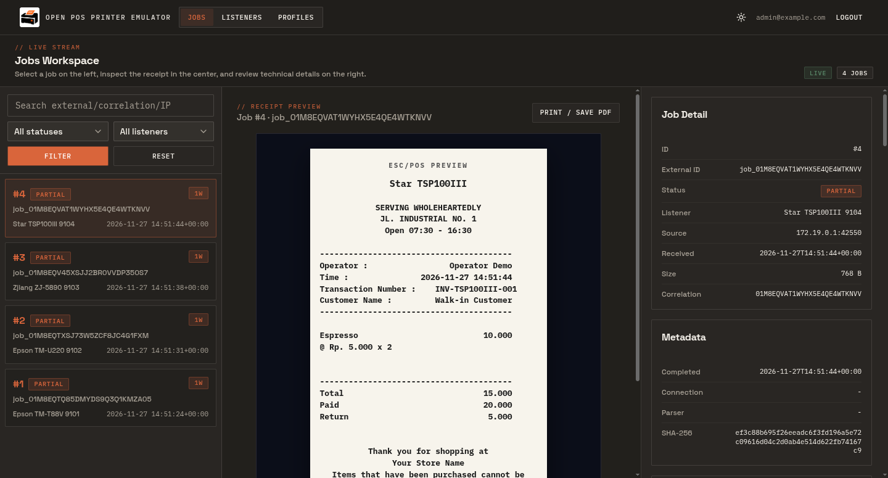

# Open POS Printer Emulator

Open POS Printer Emulator is a self-hosted open-source web application for testing ESC/POS integrations without physical printers. A POS application can send an ESC/POS byte stream over raw TCP/IP to a configurable port (default `9100`), and developers can inspect a live receipt preview, command inspector, raw hex/ASCII, and job history in the browser.

> Status: **MVP in progress**. The repo stays private until it is ready to be published.

## MVP Goals

- TCP ESC/POS listener (default 9100)
- ESC/POS command subset parsing
- Real-time live receipt preview
- Command inspector and raw data viewer
- Job history per listener
- Printer profiles
- Fault simulation
- PDF/image export
- Simple user authentication

## Stack

- **Backend:** [Laravel](https://laravel.com/) 12+ ([PHP](https://www.php.net/) 8.4+)
- **Frontend:** [Inertia.js](https://inertiajs.com/) v2 + [React](https://react.dev/) 19 + [TypeScript](https://www.typescriptlang.org/) + [shadcn/ui](https://ui.shadcn.com/) (default), Blade fallback (`?ui=blade`)
- **Real-time:** [Laravel Reverb](https://reverb.laravel.com/) + [Laravel Echo](https://laravel.com/docs/broadcasting#client-side-installation)
- **TCP Listener & Parser:** [Node.js](https://nodejs.org/) TypeScript sidecar
- **Database:** [PostgreSQL](https://www.postgresql.org/) (dev/prod container), [SQLite](https://www.sqlite.org/) `:memory:` for tests
- **Orchestration:** [Kiri](https://runkiri.com/) Compose ([Docker](https://www.docker.com/) Compose fallback for compatibility)

## Repository Structure

```text
.
├── apps/
│   ├── web/                  # Laravel + Inertia React + shadcn/ui (Blade fallback)
│   ├── sidecar/              # Node.js TCP listener + ESC/POS parser
│   └── windows-agent/        # Windows local MVP agent (Rust, SQLite, embedded UI)
├── docker/                   # Container/runtime configuration
├── .github/workflows/        # CI, E2E, Windows agent workflows
├── .internal/                # Internal planning docs (gitignored)
├── compose.yaml              # Kiri Compose
├── compose.ci.yaml           # CI override for Docker Compose E2E
└── Makefile                  # Task wrapper
```

## Quick Start

Choose your container engine. Both [Kiri](https://runkiri.com/) and [Docker Compose](https://docs.docker.com/compose/) are supported.

> **Windows local mode (MVP):** A separate single-process Windows agent is available in [`apps/windows-agent`](apps/windows-agent/). It targets local POS environments where Docker/Kiri is not practical. The MacOS/Linux container stack remains the primary full-featured mode. See [Windows distribution target](docs/user-manual/windows-distribution.md).

```bash
cp apps/web/.env.example apps/web/.env
cp apps/sidecar/.env.example apps/sidecar/.env

# Kiri (default)
make up

# Or Docker Compose
make up ENGINE=docker
```

After services are up, install dependencies and initialize the app:

```bash
# Replace `kiri compose` with `docker compose` if using Docker
kiri compose exec web composer install
kiri compose exec web php artisan key:generate
kiri compose exec web php artisan migrate --seed
```

Local endpoints:
- Web: `http://localhost:8080`
- Reverb: `ws://localhost:8081`
- TCP listener: `localhost:9100`
- Sidecar health: `http://localhost:3001/health`

## Quick Verification

```bash
printf "\x1B\x40Hello ESC/POS\n\x1D\x56\x00" | nc 127.0.0.1 9100
```

Open `/jobs` (Inertia default) or `/jobs?ui=blade` for the Blade fallback.

## Current Features

- **TCP ingest:** listener 9100 + finalize on idle timeout/client close; raw payload is preserved even when parsing fails.
- **ESC/POS subset parser:** init, align, bold/underline, text size, line spacing/feed, HT/ESC D tabs, ESC $/ positioning, cut, cash drawer, barcode/QR/image placeholders, DLE EOT status, codepages CP437/CP850/CP858/CP1252/ISO-8859-1.
- **Raster/image:** `GS v 0` and `ESC *` (supported 8-dot/24-dot modes; other modes emit warnings) are rendered as previews; `GS ( L` raster subset is supported best-effort with placeholder/warning fallback for unsupported variants.
- **Internal Laravel ingest:** token auth, payload validation, idempotent `external_id`, SHA-256 checksum.
- **Realtime Jobs:** `/jobs` via Reverb/Echo + `/jobs/feed` polling fallback. Blade fallback also has filter-aware live updates.
- **Job history UX:** filter/search/pagination/date range (`q,status,listener_id,date_from,date_to,per_page,page`) in Inertia and Blade.
- **Job detail:** receipt preview, command inspector, warnings, raw base64, Print/Save PDF and client-side PNG/text export.
- **Listener management:** CRUD/edit/delete listeners, sidecar status, heartbeat, last error, fault simulation toggles (paper_out, cover_open, cutter_error, offline), manual sync.
- **Sidecar control:** ensure/start/stop/update faults. Laravel internal listener status ingest + bootstrap endpoints. `sidecar:sync-listeners` runs on web startup and is scheduled every minute.
- **Printer Profiles MVP:** CRUD profiles (built-in profiles are not editable/deletable; profiles used by listeners are not deletable). Built-in catalog seeded from [mike42/escpos-php supported printers](https://github.com/mike42/escpos-php#printers).
- **Auth/ownership scoping:** listener/job/printer profile queries and mutations are limited to the authenticated user; built-in printer profiles remain readable.
- **Ops hardening:** `print_jobs` indexes for history/feed queries, `jobs:prune --days= --dry-run` command, `PRINT_JOBS_RETENTION_DAYS` env (default 30), daily prune schedule at 03:30.
- **Default UI:** Inertia React + shadcn/ui on `/jobs`, `/jobs/{id}`, `/listeners`, `/printer-profiles`. Blade fallback available via `?ui=blade`.

## ESC/POS Printer Server Integration

Open POS Printer Emulator can act as an ethernet target for [ESC/POS Printer Server](https://github.com/darkterminal/escpos-printer-server). This enables end-to-end testing without physical printers.

```text
POS/Web App -> WebSocket (JSON) -> ESC/POS Printer Server -> raw ESC/POS TCP -> Open POS Printer Emulator -> Jobs UI
```

### Quick E2E

```bash
# Terminal 1: emulator
make up

# Terminal 2: ESC/POS Printer Server
php eps --role ws --host 127.0.0.1 --port 1945 --log-dir /tmp/eps-logs start

# Terminal 3: send sample payload
node examples/escpos-printer-server/send-job.mjs
```

Sample payload key fields:

```json
{
  "printer_settings": {
    "interface": "ethernet",
    "printer_host": "127.0.0.1",
    "printer_port": 9100,
    "template": "epson"
  },
  "receipt_data": {
    "transaction": {
      "paid_return": 5000
    }
  }
}
```

See [`examples/escpos-printer-server/`](examples/escpos-printer-server/) and [docs integration guide](docs/user-manual/integration-escpos-printer-server.md) for full payload and troubleshooting.

## Supported Printer Profiles (escpos-php)

Printer profiles are seeded from [mike42/escpos-php](https://github.com/mike42/escpos-php)'s supported printer list. OPPE stores profile metadata (paper width, chars/line, DPI, dots, codepage) for emulator/listener mapping; actual rendering is best-effort by the OPPE parser/preview.

<details>
<summary>Show supported printer list</summary>

- 3nStar RPT-008
- Approx APPPOS80AM
- AURES ODP-333 / ODP-500
- Bematech-4200-TH / LR2000E
- Birch PRP-085III
- Bixolon SRP-350III / SRP-350Plus
- Black Copper BC-85AC
- CHD TH-305N
- Citizen CBM1000-II / CT-S310II
- Dapper-Geyi Q583P
- Daruma DR800
- DR-MP200
- EPOS TEP 220M
- Elgin i9
- Epson EU-T332C, FX-890, TM-T20/T20II, TM-T70/T70II, TM-T81, TM-T82II, TM-T88II/III/IV/V, TM-U220, TM-U295, TM-U590/TM-U590P
- Equal (EQ-IT-001) POS-58
- Everycom EC-58
- Excelvan HOP-E200 / HOP-E58 / HOP-E801
- Gainscha GP-2120TF / GP-5890x / GP-U80300I
- gprinter GP-U80160I
- HOIN HOP-H58
- Ithaca iTherm 28
- Hasar HTP 250
- Metapace T-1 / T-25
- Nexa PX700
- Nyear NP100
- OKI RT322 / 80 Plus III
- Orient BTP-R580
- P-822D / P85A-401
- Partner Tech RP320
- POSLIGNE ODP200H-III-G
- QPOS Q58M
- Rongta RP326US / RP58-U / RP80USE
- SAM4S GIANT-100DB
- Senor TP-100
- Sewoo SLK-TS400
- SEYPOS PRP-96 / PRP-300
- SNBC BTP-R880NPIII
- Solux SX-TP-88300
- Sicar POS-80
- Silicon SP-201 / RP80USE
- SPRT SP-POS88V
- Star BSC10, TSP100 ECO, TSP100III FuturePRNT, TSP-650, TUP-592
- TVS RP45 Shoppe
- Venus V248T
- Xeumior SM-8330
- Xprinter F-900, XP-365B, XP-58 Series, XP-80C, XP-90, XP-Q20011, XP-Q800
- Zjiang NT-58H, ZJ-5870, ZJ-5890, ZJ-8220, ZJ-8250

</details>

## Screenshots

| Printer Profiles | Listeners |
|---|---|
|  |  |

| TM-T88V / 9101 | TM-U220 / 9102 |
|---|---|
|  |  |

| ZJ-5890 / 9103 | Star TSP100III / 9104 |
|---|---|
|  |  |

## Testing & Checks

```bash
# Kiri (default)
make test
make lint

# Docker Compose
make test ENGINE=docker
make lint ENGINE=docker

make e2e   # requires an active stack at localhost:8080
```

Manual checks (replace `kiri compose` with `docker compose` if using Docker):

```bash
kiri compose exec web php artisan test
kiri compose exec web ./vendor/bin/pint --test
kiri compose exec sidecar npm test
kiri compose exec sidecar npm run lint
kiri compose exec web npm run build
```

Committed Playwright E2E smoke:

```bash
cd apps/web
npm ci
npx playwright install chromium
E2E_BASE_URL=http://localhost:8080 npx playwright test
```

Smoke covers: admin login, jobs page, printer profile create, TCP ingest, job detail export controls. Use an ephemeral DB/stack for CI; local smoke may create test data.

## CI

- `.github/workflows/ci.yml`: web [Pint](https://laravel.com/docs/pint) + [PHPUnit](https://phpunit.de/) (SQLite `:memory:`), sidecar lint + [Vitest](https://vitest.dev/).
- `.github/workflows/e2e.yml`: [Docker Compose](https://docs.docker.com/compose/) stack (`compose.yaml` + `compose.ci.yaml`), migrate/seed/build, [Playwright](https://playwright.dev/) smoke, upload trace/logs on failure.

## Troubleshooting

- **Kiri BuildKit mirror timeout**: if a build fails due to a local mirror, use a `docker-container` builder without a mirror, build with `--load`, then `kiri compose up -d --no-build`. Docker Compose users are not affected by this Kiri-specific issue.
- **Reverb not live**: check `make ps` (or `make ps ENGINE=docker`) for the `reverb` service and port `8081`; the jobs UI has a polling fallback.
- **Blade fallback stale**: use `/jobs?ui=blade`; the fallback has filter-aware live updates, but still verify with polling/feed fetch.
- **Tests delete dev data**: do not override `phpunit.xml` env; tests must run on SQLite `:memory:`.
- **Sidecar status stale**: run `kiri compose exec web php artisan sidecar:sync-listeners` (or `docker compose exec ...`).
- **Retention/prune**: check `PRINT_JOBS_RETENTION_DAYS`; dry-run safely with `kiri compose exec web php artisan jobs:prune --dry-run` (or `docker compose exec ...`).
- **E2E flakiness**: ensure web/reverb/sidecar/db are healthy, ports 8080/8081/9100/3001 are free, and use the trace in `apps/web/test-results` on failure.

## License

[Apache License 2.0](LICENSE)
