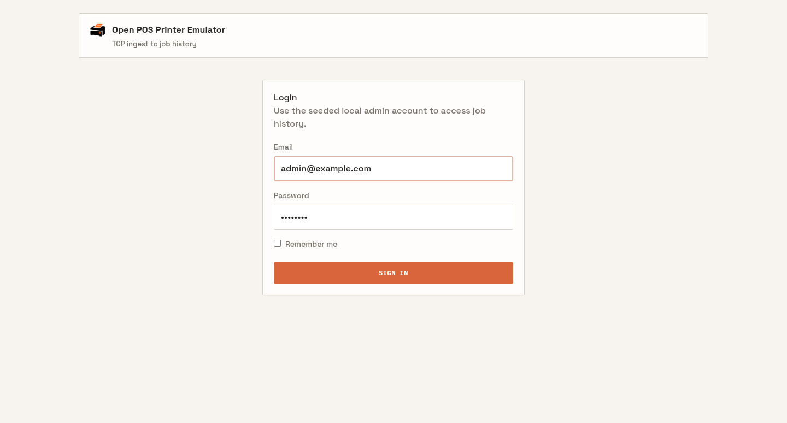
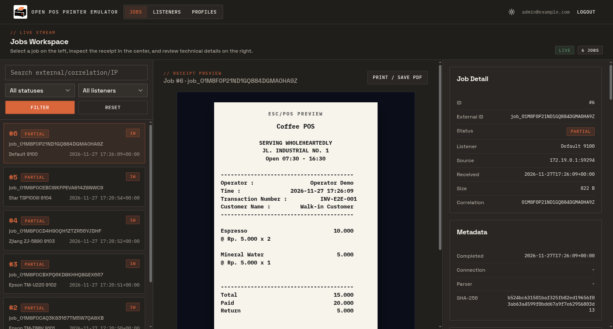

This page helps you get the emulator running on your machine. If you only want to learn how to use the web UI, go directly to the **[User guide](user-guide.md)**.

## Requirements

- **Kiri** (default) or **Docker Compose**
- Ports available: `8080` (web), `8081` (Reverb), `9100` (TCP listener), `3001` (sidecar), `5432` (Postgres)
- `nc` (netcat) for the quick TCP smoke test (optional)

## 1. Prepare Environment Files

```bash
cp apps/web/.env.example apps/web/.env
cp apps/sidecar/.env.example apps/sidecar/.env
```

## 2. Start the Stack

**Kiri (default):**

```bash
make up
```

**Docker Compose:**

```bash
make up ENGINE=docker
```

Wait until services are up. You can check with:

```bash
make ps
# or: make ps ENGINE=docker
```

## 3. Initialize the Laravel App

Run these commands using the same engine you started with.

**Kiri:**

```bash
kiri compose exec web composer install
kiri compose exec web php artisan key:generate
kiri compose exec web php artisan migrate --seed
```

**Docker Compose:**

```bash
docker compose exec web composer install
docker compose exec web php artisan key:generate
docker compose exec web php artisan migrate --seed
```

## 4. Open the Web UI

Open `http://localhost:8080/login` in your browser.

**Default local credentials:**

- **Email:** `admin@example.com`
- **Password:** `password`



## 5. Send Your First Test Print

Send a simple ESC/POS payload to the default TCP listener on port `9100`:

```bash
printf "\x1B\x40Hello ESC/POS\n\x1D\x56\x00" | nc 127.0.0.1 9100
```

Then open the **Jobs** page (`http://localhost:8080/jobs`). You should see a new job in the left panel and the receipt in the center preview.



## 6. Where to Go Next

- **[User guide](user-guide.md)** — step-by-step walkthrough of Jobs, Listeners, and Printer Profiles.
- **[Integration with ESC/POS Printer Server](integration-escpos-printer-server.md)** — send real POS-style receipts through EPS into OPPE.
- **[Troubleshooting](troubleshooting.md)** — common issues and fixes.

## Useful Commands

```bash
make up          # Start stack (Kiri default)
make ps          # Check service status
make logs        # Follow logs
make test        # Run tests
make lint        # Run lint/format checks
make down        # Stop stack
```

For Docker Compose, append `ENGINE=docker` to make commands, e.g. `make up ENGINE=docker`.