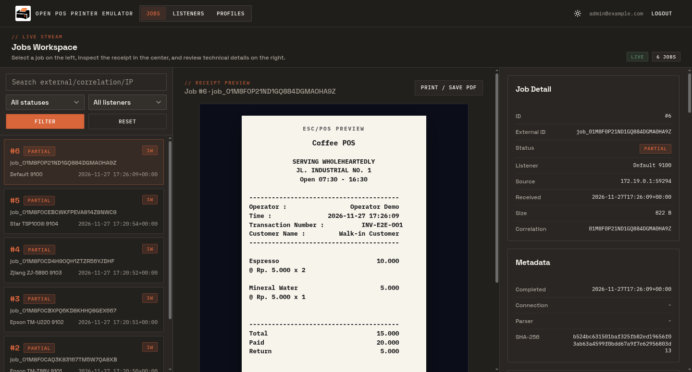

## What is Open POS Printer Emulator?

**Open POS Printer Emulator** is a self-hosted, open-source web application for testing ESC/POS printer integrations **without a physical printer**.

> **Development only:** this tool is designed for local development, QA, and integration testing. It is not recommended for production deployment.

Instead of printing to hardware during development or QA, your POS/application sends ESC/POS data to the emulator. The emulator receives the data, stores it as a job, and shows it in a web UI where you can inspect the receipt preview and technical details.

## How It Works

The system uses a [Node.js](https://nodejs.org/) sidecar for TCP/ESC-POS parsing, [Laravel](https://laravel.com/) for ingest/storage, and [Laravel Reverb](https://reverb.laravel.com/) for realtime updates.

flowchart LR
    A["POS / Application"] -->|"ESC/POS bytes over TCP default port 9100"| B["Open POS Printer Emulator"]
    B --> C["Parse &amp; store job"]
    C --> D["Web UI /jobs"]
    D --> E["Receipt Preview Warnings / Raw Data"]

Data flow from your POS/application to the receipt preview in the browser.

## Who Is This For?

### Non-technical users / QA / operations

- Confirm that a POS or app is sending print jobs.
- View the receipt in a browser.
- Share job ID and screenshot with developers when something looks wrong.

Start here: **[User guide](user-guide.md)**.

### Developers / integrators

- Debug ESC/POS payloads and parser warnings.
- Inspect raw hex/base64 and parsed commands.
- Test multiple listeners/printer profiles.
- Integrate before using real hardware.

Start here: **[Getting started](getting-started.md)**, then **[Integration with ESC/POS Printer Server](integration-escpos-printer-server.md)**.

## Web UI at a Glance

The Jobs Workspace is the main screen: job history on the left, receipt preview in the center, and job details on the right.

## Key Features

- **TCP ESC/POS ingest** — receive raw printer data on configurable listeners (default `9100`).
- **Receipt preview** — visual rendering of supported ESC/POS commands.
- **Command inspector** — parsed command list for debugging.
- **Raw data viewer** — hex/base64 payload for deep inspection.
- **Realtime updates** — new jobs appear live (with polling fallback).
- **Listeners & printer profiles** — manage ports and printer presets.
- **Fault simulation** — simulate printer errors like paper out or cover open.
- **Self-hosted** — run locally with [Kiri](https://runkiri.com/) or [Docker Compose](https://docs.docker.com/compose/).

## Documentation Map

| Page | Description |
| --- | --- |
| **[Getting started](getting-started.md)** | Install, run, and send your first test print. |
| **[User guide](user-guide.md)** | Step-by-step web UI guide for non-technical users. |
| **[Integration with ESC/POS Printer Server](integration-escpos-printer-server.md)** | End-to-end POS-like integration example. |
| **[Technical guide](technical-guide.md)** | Architecture, config, internal contract, and commands. |
| **[Troubleshooting](troubleshooting.md)** | Common issues and fixes. |

  
<strong>Support this project</strong> — Open POS Printer Emulator is free and open source. If it saves you time, consider <a href="https://github.com/sponsors/darkterminal" target="_blank" rel="noopener noreferrer">sponsoring @darkterminal</a> or starring the repo on <a href="https://github.com/darkterminal/open-pos-printer-emulator" target="_blank" rel="noopener noreferrer">GitHub</a>.

