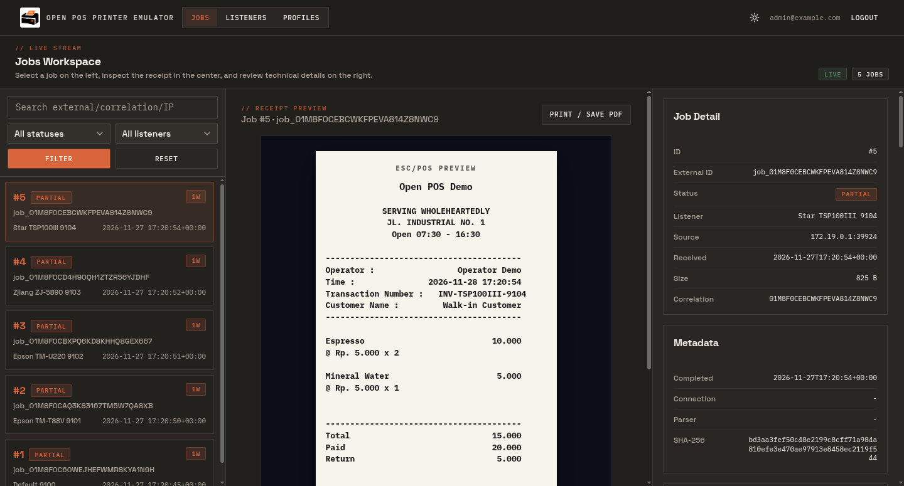
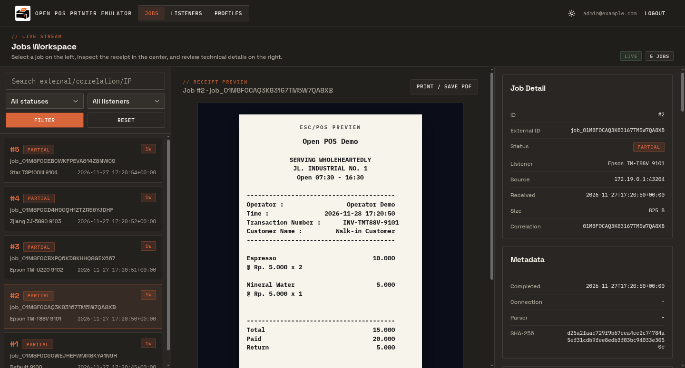
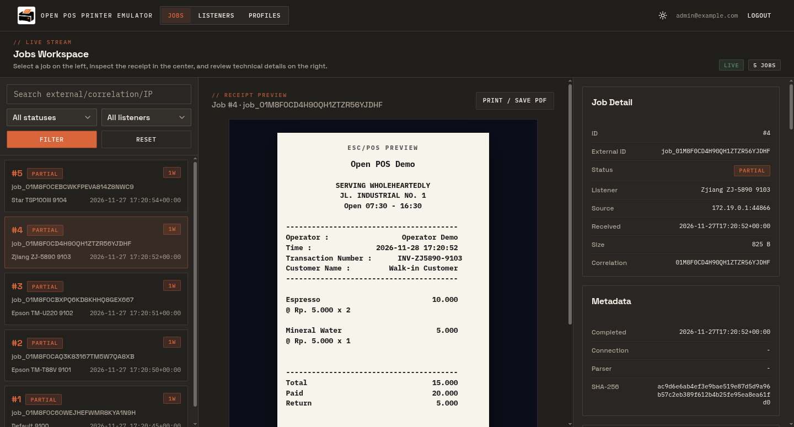

## Why This Integration

[ESC/POS Printer Server](https://github.com/darkterminal/escpos-printer-server) accepts print jobs (WebSocket JSON) and sends ESC/POS commands to a printer interface. Open POS Printer Emulator can act as that printer target.

```text
POS/Web App
  -> WebSocket (JSON print job)
  -> ESC/POS Printer Server
  -> Ethernet TCP (raw ESC/POS)
  -> Open POS Printer Emulator :9100
  -> Jobs UI / preview / inspector
```

## Prerequisites

- Open POS Printer Emulator running (`http://localhost:8080`, TCP `9100`).
- ESC/POS Printer Server running (`ws://localhost:1945` by default).

## Configure the Printer Target

In the ESC/POS Printer Server print job, set `printer_settings` to target the emulator:

```json
{
  "interface": "ethernet",
  "printer_host": "127.0.0.1",
  "printer_port": 9100,
  "template": "epson"
}
```

Use a host reachable from the ESC/POS Printer Server process:

- Same machine/native: `127.0.0.1`
- Container to host (common): `host.docker.internal`
- Same compose network: service/container DNS name

## Full Example Payload

Send this JSON to `ws://localhost:1945`:

```json
{
  "from": "posclient",
  "printer_name": "EMULATOR-9100",
  "printer_settings": {
    "interface": "ethernet",
    "printer_host": "127.0.0.1",
    "printer_port": 9100,
    "template": "epson",
    "pull_cash_drawer": false
  },
  "receipt_data": {
    "app_name": "Coffee POS",
    "store_address": "Jl. Industrial No. 1",
    "full_name": "Operator Name",
    "transaction": {
      "date_transaction": "2026-11-27",
      "transaction": "INV-00123",
      "tax": 0,
      "total_transaction": 15000,
      "paid": 20000,
      "paid_return": 5000,
      "payment": "Cash"
    },
    "cart": [
      {
        "item_name": "Espresso",
        "price": 5000,
        "qty": 2,
        "sub_total": 10000
      },
      {
        "item_name": "Mineral Water",
        "price": 5000,
        "qty": 1,
        "sub_total": 5000
      }
    ]
  }
}
```

## End-to-End Example (Included)

The repository includes a runnable example at `examples/escpos-printer-server/`:

- `sample-receipt.json` — sample payload
- `send-job.mjs` — Node.js WebSocket sender (Node 21+)
- `run-demo.sh` — prerequisite checks + send

Run:

```bash
# terminal 1: emulator repo
make up

# terminal 2: escpos-printer-server repo
php eps --role ws --host 127.0.0.1 --port 1945 --log-dir /tmp/eps-logs start

# terminal 3: emulator repo
node examples/escpos-printer-server/send-job.mjs
```

## Verify

1. ESC/POS Printer Server accepts the WebSocket job.
2. Emulator receives TCP payload on `9100`.
3. A new job appears in `/jobs`.
4. Inspect preview, warnings, command inspector, and raw data.

## Verified E2E Evidence (Playwright MCP)

Representative real-payload smoke tests were executed from **ESC/POS Printer Server** to OPPE using the sample receipt payload structure (including `transaction.paid_return`). This is a documentation sample, not a full 91-profile screenshot matrix; all 91 escpos-php profiles were previously smoke-tested over TCP ingest.

| Profile | Listener | EPS Result | Screenshot |
|---|---:|---|---|
| Generic ESC/POS | 9100 | `[SUCCESS] Receipt printed successfully` |  |
| Epson TM-T88V | 9101 | `[SUCCESS] Receipt printed successfully` |  |
| Zjiang ZJ-5890 | 9103 | `[SUCCESS] Receipt printed successfully` |  |

Additional successful profiles in the same run: **Epson TM-U220 (9102)** and **Star TSP100III FuturePRNT (9104)**.

## Troubleshooting

- **No job in emulator**: check `printer_host/printer_port`, listener status, and network reachability.
- **Wrong host from container**: `127.0.0.1` inside a container points to that container, not your host.
- **Preview differs**: emulator support is best-effort for some commands; validate final output on physical hardware.
