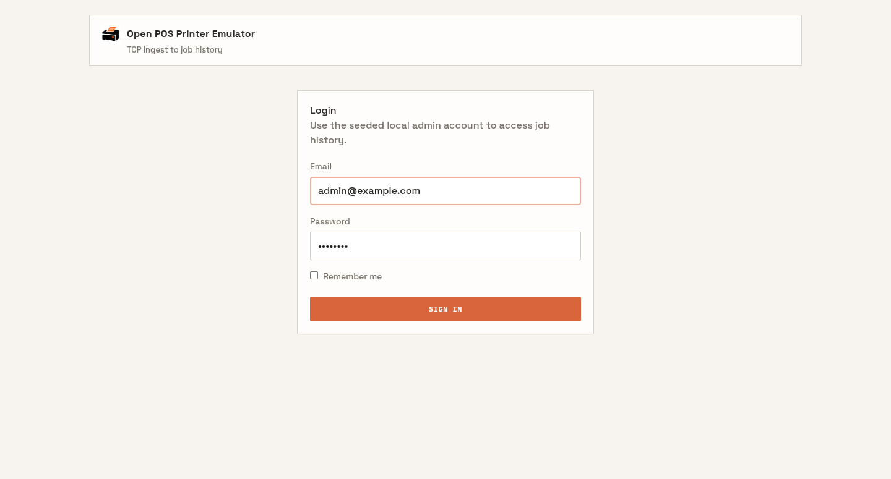
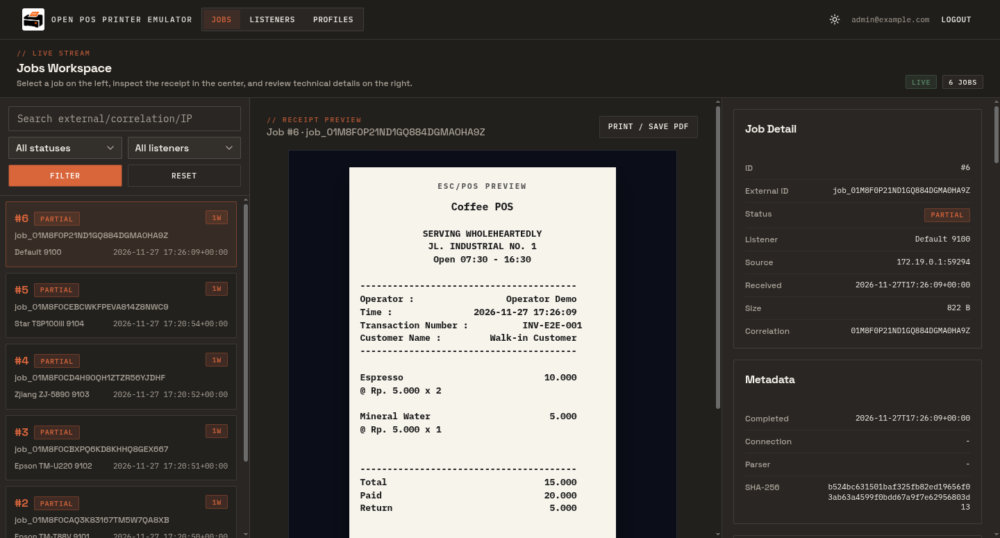
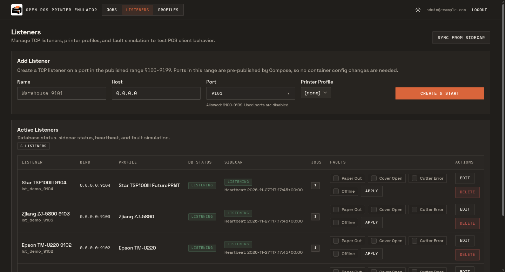
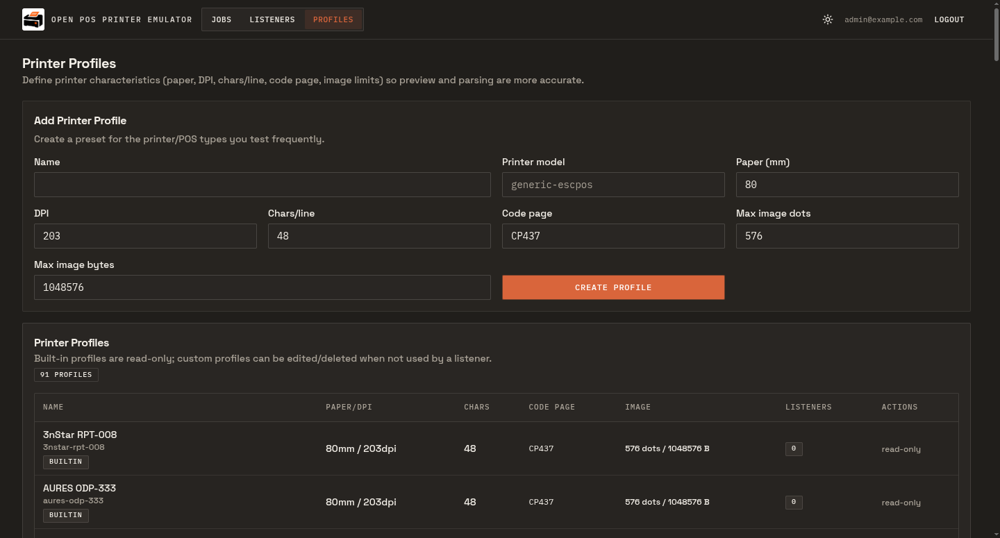

This guide is written for **non-technical users** who want to use the web UI to confirm that print jobs are arriving and to view receipts. It also includes notes for developers where useful.

## What You Can Do in the Web UI

| Page | What it’s for |
| --- | --- |
| **Jobs** | See incoming print jobs, preview receipts, and inspect job details. |
| **Listeners** | See which TCP ports are receiving printer data and check their status. |
| **Printer Profiles** | See printer presets (paper size, characters per line, etc.) used by listeners. |

> **Default local URL:** `http://localhost:8080`  
> **Default local login:** `admin@example.com` / `password`

---

## Step-by-Step: From Login to Receipt Preview

### Step 1 — Open the Web UI and Sign In

1. Open your browser and go to the emulator URL (local default: `http://localhost:8080/login`).
2. Enter your **Email** and **Password**.
3. Optionally check **Remember me**.
4. Click **Sign in**.

After signing in, you will be taken to the **Jobs Workspace**.



### Step 2 — Understand the Jobs Workspace

The **Jobs** page is the main screen. It is divided into three areas:

1. **Left panel — Job History**  
   Shows received print jobs. You can search and filter jobs here.
2. **Center panel — Receipt Preview**  
   Shows the visual receipt for the selected job. This is where you confirm what the receipt looks like.
3. **Right panel — Job Detail**  
   Shows technical information: status, listener, timestamps, warnings, parsed commands, and raw data.

At the top, you’ll see the live connection indicator and total job count.



### Step 3 — Make Sure a Print Job Arrives

If your POS or application is already configured to send ESC/POS data to the emulator, send a test print from that system.

For a quick local test (developer/admin), you can send a sample receipt over TCP to the default listener port `9100`:

```bash
printf "\x1B\x40Hello ESC/POS\n\x1D\x56\x00" | nc 127.0.0.1 9100
```

After the job is received:

- The job count increases.
- A new job appears in the **Job History** list on the left.
- The receipt appears in the **Receipt Preview** when selected.

> **Tip:** If you use Docker/Kiri, make sure the emulator stack is running and port `9100` is exposed.

### Step 4 — Select the Job in Job History

1. Look at the **left panel** (Job History).
2. Click the job you want to inspect. Each job card shows:
   - Job ID (e.g. `#6`)
   - Status (`parsed`, `partial`, `parse_error`)
   - External/correlation ID
   - Listener name
   - Received time
3. The selected job will be highlighted.

### Step 5 — Check the Receipt Preview

1. Look at the **center panel**.
2. Confirm the receipt content is displayed correctly: store name, items, totals, payment, return/change, and cut marker.
3. Use **Print / Save PDF** if you want to save the preview from your browser.

**What to look for:**

- **Receipt looks correct** — the POS payload was received and rendered.
- **Receipt looks incomplete** — check job status/warnings in the right panel.
- **No job appears** — check listener status and that your POS is sending to the correct host/port.

### Step 6 — Review Job Details (Optional but Helpful)

The **right panel** gives more detail about the selected job:

- **Metadata** — job IDs, listener, source IP, received/completed time, payload size, SHA-256.
- **Warnings** — parser warnings, such as unsupported commands. `partial` status often means warnings exist.
- **Command Inspector** — parsed ESC/POS commands with offsets/args. Useful for developers.
- **Raw Data Viewer** — hex and base64 payload. Useful for debugging or sharing with support/developers.

If you need to report an issue, share: **Job ID**, **External ID**, **received time**, **status**, and a screenshot.

---

## Other Pages

### Listeners

The **Listeners** page shows TCP ports that receive ESC/POS data. Most non-technical users only need to confirm that a listener is **listening** on the expected port (default `9100`).

You can also see:

- Listener name and external ID
- Bind host/port
- Assigned printer profile
- DB status and sidecar status
- Heartbeat and last error
- Job count
- Fault simulation toggles (for testing error scenarios)



### Printer Profiles

The **Printer Profiles** page contains printer presets. These profiles help the emulator interpret and preview receipts with printer-specific characteristics.

- **Built-in profiles** are read-only.
- **Custom profiles** can be created by admins/developers when needed.
- Listeners can be mapped to a profile.



---

## Common Statuses

| Status | What it means | What to do |
| --- | --- | --- |
| `parsed` | Job parsed successfully. | Review receipt preview. |
| `partial` | Job parsed, but with warnings/unsupported commands. | Check Warnings and Command Inspector. |
| `parse_error` | Parser could not fully parse the payload. | Check Raw Data Viewer; share job details with a developer. |

## Troubleshooting for Non-Technical Users

- **I can’t log in** — confirm the URL and credentials. For local seeded dev, use `admin@example.com` / `password`.
- **No jobs appear** — confirm the POS is sending to the correct IP and port (default `9100`), and the listener is active.
- **Receipt preview looks strange** — the command may be unsupported or partially supported. Check status/warnings; the raw payload is still saved.
- **Need help** — take a screenshot and include Job ID, time, and listener name.

For more detailed fixes, see [Troubleshooting](troubleshooting.md). Developers can also read the [Technical guide](technical-guide.md).